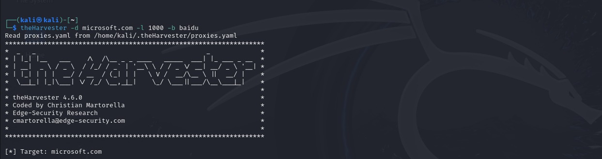
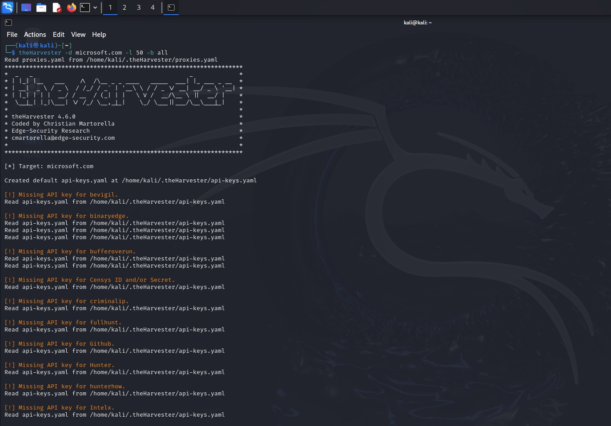

# NETWORKWALKS-RUSHDHA-B084K-WK2-PM4-theharvester-footprinting
Practical cybersecurity OSINT exercise using theHarvester to gather publicly available email addresses and subdomain information associated with a target domain through multiple search engine and data sources.

# W2-PM4 – Footprinting & Reconnaissance with theHarvester

## Project Overview

This practical cybersecurity exercise focuses on using **theHarvester**, an OSINT tool designed to gather publicly available information about a target domain.

The tool helps security professionals collect information such as email addresses, subdomains, hostnames, and other domain-related details from publicly available sources.

In this exercise, theHarvester was used to investigate the `microsoft.com` domain using different search source configurations.

## Objectives

- Understand the purpose and functionality of theHarvester.
- Perform domain-based footprinting and reconnaissance.
- Gather publicly available email address and subdomain information.
- Explore different data sources supported by theHarvester.
- Compare reconnaissance using a specific search source and multiple available sources.

## Tools and Technologies

| Tool | Purpose |
|---|---|
| Kali Linux | Operating system used for the practical exercise |
| theHarvester | OSINT tool for gathering domain-related information |
| Baidu | Search source used for information gathering |
| All Sources | Configuration for searching across supported sources |
| Terminal | Executing commands and reviewing results |

## Practical Methodology

### Task 01 – Reconnaissance Using Baidu

The first task involved using theHarvester to gather publicly available information associated with the `microsoft.com` domain through the Baidu search source.

**Command executed:**

```bash
theHarvester -d microsoft.com -l 1000 -b baidu
```

**Command parameters:**

| Parameter | Description |
|---|---|
| `-d microsoft.com` | Specifies the target domain |
| `-l 1000` | Sets the maximum number of results to retrieve |
| `-b baidu` | Specifies Baidu as the data source |

This task demonstrated how theHarvester can use a specific search source to collect domain-related information.

### Task 02 – Reconnaissance Using All Available Sources

The second task involved running theHarvester against the same target domain using the `all` source configuration.

**Command executed:**

```bash
theHarvester -d microsoft.com -l 50 -b all
```

**Command parameters:**

| Parameter | Description |
|---|---|
| `-d microsoft.com` | Specifies the target domain |
| `-l 50` | Sets the maximum number of results to retrieve |
| `-b all` | Requests information from all sources supported by the installed version |

This task demonstrated how using multiple data sources can provide a broader approach to domain footprinting.

The results depend on source availability, API requirements, configuration, and service limitations.

## Screenshots and Evidence

The following screenshots document the practical activities:

### 01 – theHarvester Baidu Search



### 02 – theHarvester All Sources Search



## Key Learning Outcomes

- Gained practical experience using theHarvester for OSINT investigations.
- Learned how to specify target domains and configure search sources.
- Understood how different data sources contribute to information gathering.
- Explored the collection of publicly available email addresses and subdomain information.
- Developed an understanding of passive reconnaissance techniques.
- Recognised that results may vary depending on source availability and API restrictions.

## Ethical Considerations

Domain footprinting should only be conducted for authorised educational, research, or security assessment purposes. Publicly available information must be handled responsibly and should not be used for unauthorised access, phishing, or other malicious activities.

## Conclusion

This exercise provided practical experience with theHarvester as an OSINT and reconnaissance tool. By performing searches using Baidu and the all-sources configuration, the activity demonstrated different approaches to gathering publicly available domain-related information and highlighted the importance of reconnaissance in cybersecurity assessments.

---

**Project:** NetworkWalks Cybersecurity Internship – Week 02  
**Task:** W2-PM4 – Footprinting & Reconnaissance with theHarvester  
**Author:** Rushdha
